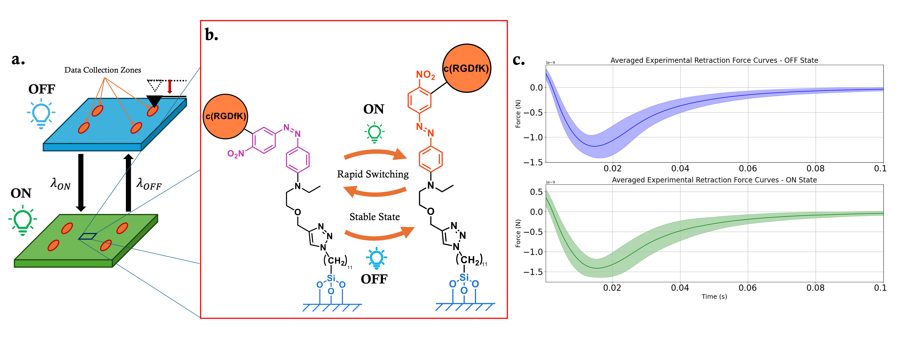
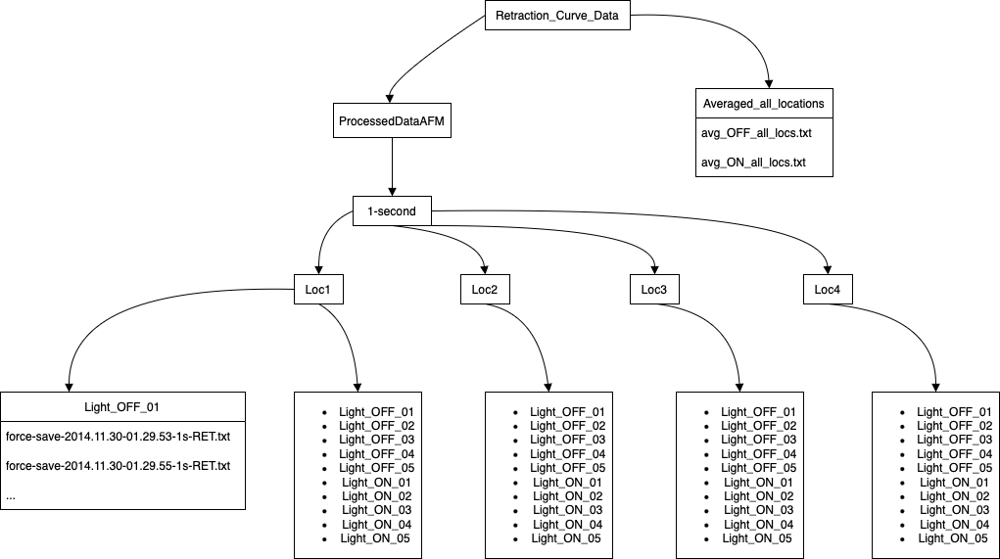

# Spring_Model_with_SCFM
This repository holds the necessary C/C++, Python, and raw data to generate the results from the publication that relates to this repository.
The parameter fitting used the scipy.optimize.minimize library, and the simulation used a numerical differential equation solver written in C++ files.
This code was written and compiled on a Linux-based machine. If using a Mac or Windows, changes must be made to the 
subprocess module. These are left to the discretion of the user.  

## The necessary instillation requirements:
### C++:
  * Standard C++/C compiler: GCC, g++, clang, and so on 

### Python:
  * scipy

    - scipy.minimize.optimize
  
    - scipy.stats.qmc   

  * numpy

  * subprocess - for executing C++ scripts from a Python wrapper

  * matplotlib (only for recreating plots) - not a dependency  
 
## Code Structure:

The code is necessary to optimise the averaged retraction curve for the **OFF** and **ON**. 

* *fitting_OFF* provides the code for producing a file containing 50 sets of optimised parameters by running the command *python3 fit_OFF.py*. Running the code generates two text files *init_Param_all_OFF_LHS_Nelder_L2_50.txt* with the initial guess and *Est_Param_all_OFF_LHS_Nelder_L2_50.txt* for the optimised sets.  

* *fitting_ON* provides the code required to produce the 250 optimised parameter sets from the sets fitted to the **OFF** dataset. Similarly, initial parameters generated through the Latin Hypersquare method can be found in *init_Param_all_OFF_LHS_Nelder_L2_250.txt*, and the optimised parameters are deposited in *Est_Param_all_OFF_LHS_Nelder_L2_250.txt*. 

* *switching_lighting* provides the adjusted code needed for simulations where parameter values switch between **OFF** and **ON**. This is meant to simulate the lighting changes, and the effect of this can be seen in the main article. 

## Structure of the raw retraction curves



Figure illustrating how the data was collected and correlation to file structure. The paper explains the experimental conditions for data collected here: [*Laith Kadem et al.*](https://doi.org/10.1002/ange.201609483). If you wish to use the data in your own work please reach out to the owners of the data at the following email address: Christine.Selhuber-Unkel@uni-heidelberg.de. 

If the data is used please include the following citation in any publications:
```bibtex
@article{kadem2017high,
  title={High-frequency mechanostimulation of cell adhesion},
  author={Kadem, Laith F and Suana, K Grace and Holz, Michelle and Wang, Wei and Westerhaus, Hannes and Herges, Rainer and Selhuber-Unkel, Christine},
  journal={Angewandte Chemie},
  volume={129},
  number={1},
  pages={231--235},
  year={2017},
  publisher={Wiley Online Library}
}   
```

### File structure:
The files have been processed to remove the single-cell force microscopy approach, leaving only the retraction. The files are organised in the following format:

*Retraction_Curve_Data* 
* *Averaged_all_locations* > consists of 2 retraction curves, one for **OFF** and other for **ON** averaged across all locations. 

* *ProcessedDataAFM*


The text files have the following format in the text files. The column headings are omitted, but all text files follow the same column structure.    

```
Vertical Tip Position (m)  Vertical Deflection (N)    Height (m)      Head Height (measured & smoothed) (m)  Head Height (measured) (m)  Series Time (s)  Segment Time (s)
-1.003386e-07                5.171216e-10              0.000003                 -1.087966e-07                      -1.032100e-07           1.406006      0.000244       
-9.135477e-08                4.797444e-10              0.000003                 -9.920142e-08                      -9.413498e-08           1.406494      0.000732      
-8.242706e-08                4.374140e-10              0.000003                 -8.958136e-08                      -8.486887e-08           1.406982      0.001221 
 ...                         ...                      ...                        ...                                ...                   ...           ...
 ```